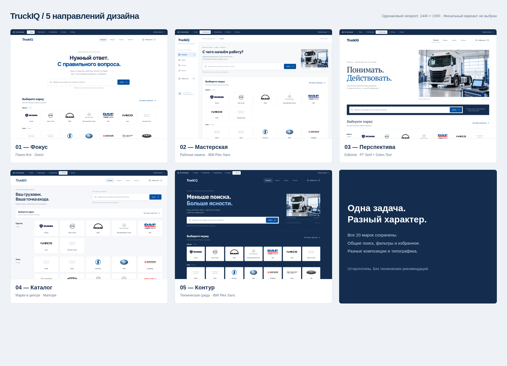

# Пять концепций TruckIQ

Финальный вариант и шрифт не выбраны. Все экраны сняты при одинаковом viewport 1440 × 1000.

| Вариант | Изображение | Характер |
|---|---|---|
| 01 — Фокус | [Открыть PNG](01-focus.png) | Центрированный поиск, Onest |
| 02 — Мастерская | [Открыть PNG](02-workbench.png) | Боковая рабочая навигация, IBM Plex Sans |
| 03 — Перспектива | [Открыть PNG](03-editorial.png) | Editorial, PT Serif + Golos Text |
| 04 — Каталог | [Открыть PNG](04-catalog.png) | Крупные карточки марок, Manrope |
| 05 — Контур | [Открыть PNG](05-contour.png) | Тёмно-синий технический интерфейс, IBM Plex Sans |

Все варианты сохраняют 20 марок, из них 16 с настоящими изображениями. Renault Trucks, Sitrak, Howo и Mitsubishi Fuso пока представлены текстовыми карточками. Это только UI: реальных ремонтных инструкций и диагностических данных нет.

Запуск локальной галереи описан в [основном README](../../README.md). Сайт не опубликован.
